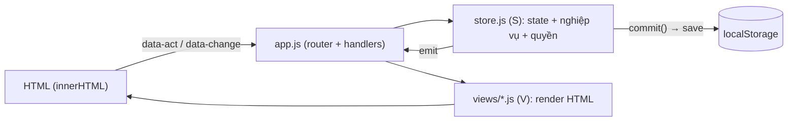

# Báo cáo tổng quan – i8studio MGR (bản demo)

> Live: **https://iwork.i8studio.vn** · Mã nguồn: `d:\Projects\I8STUDIO_MGR_DEMO`
> Phiên bản hiện tại: cache `?v=61`, dữ liệu `VER = 17` (13/10/2026)

## 1. Webapp này là gì
Hệ thống quản lý sản xuất cho studio phối cảnh 3D (kiến trúc, nội/ngoại thất, phim 3D, VR):
- Quản lý **job/dự án** theo mã chuẩn `SốJob_MãKhách_TênVI_TênJP` (VD `2139_J_Du an video Hakuba…_白馬青木湖…`).
- Chia job thành **giai đoạn (phase) → task**. Mỗi task gán người làm, có điểm và giờ thực tế.
- Luồng duyệt: Staff làm → Leader/QA check → khách review → sửa → hoàn thành.
- Chấm công, OT, nghỉ phép, KPI điểm/giờ, dashboard cho BOD.
- Phân quyền 7 vai trò: **Staff, Leader, CS (PM), QA, Báo giá, BOD, Admin (IT)**.

**Tình trạng: đây là DEMO / PROTOTYPE chạy hoàn toàn trên trình duyệt**, chưa có backend.

## 2. Công nghệ & kiến trúc

| Hạng mục | Hiện trạng |
|---|---|
| Frontend | HTML + **JavaScript thuần (ES5, không framework)** + CSS thuần |
| Build | Không có bước build: `index.html` nạp thẳng 23 file JS/CSS, cache bằng `?v=` |
| Dữ liệu | **Lưu trong `localStorage` của trình duyệt** (key `i8mgr_demo_v1`). Dữ liệu mẫu sinh từ `seed.js` |
| Backend / DB / API | **Chưa có** |
| Đăng nhập | Demo phía client (tài khoản mẫu), **không có bảo mật thật** |
| Hosting | File tĩnh trên server Linux (`/var/www/iwork.i8studio.vn`), deploy bằng `scp` |
| Test | Node (mock DOM) + **Playwright** (Edge headless) |

Mô hình code (3 đối tượng toàn cục):
- `S` – **store** ([store.js](file:///d:/Projects/I8STUDIO_MGR_DEMO/js/store.js)): state, danh mục, ma trận quyền `S.can()`, nghiệp vụ tạo/sửa dự án, thông báo. Mỗi thay đổi gọi `commit()`, sau đó lưu và render lại.
- `V` – **views** (`js/views/*.js`): mỗi màn hình là một hàm trả về chuỗi HTML (`V.views.<route>(args)`).
- `U` – **tiện ích** ([util.js](file:///d:/Projects/I8STUDIO_MGR_DEMO/js/util.js)): ngày giờ, escape, toast, modal…
- [app.js](file:///d:/Projects/I8STUDIO_MGR_DEMO/js/app.js): router theo hash (`#/projects`, `#/project/<id>`…). Bắt sự kiện kiểu ủy quyền (event delegation): `data-act` cho click, `data-change` cho thay đổi. Mỗi lần đổi là **render lại cả màn hình** bằng `innerHTML`.

## 3. Cấu trúc file chính (~9.000 dòng JS + 4.300 dòng CSS)

| File | Dòng | Vai trò |
|---|---|---|
| store.js | 819 | State, quyền, tạo/sửa dự án, phạm vi dữ liệu |
| logic_task.js / logic_time.js | 417 / 285 | Vòng đời task, bấm giờ, chấm công |
| seed.js / seed_time.js | 368 / 74 | Dữ liệu mẫu (15 dự án, ~20 user) |
| app.js | 785 | Router + toàn bộ handler sự kiện |
| views/projects.js | 812 | Danh sách dự án + form tạo/sửa |
| views/project.js + project_tabs.js | 598 + 241 | Chi tiết job, Waterfall/Gantt, thêm task |
| views/dashboard.js | 766 | Dashboard BOD/Leader |
| views/shell.js | 797 | Sidebar, topbar, tìm kiếm nhanh |
| views/kanban.js | 406 | Kanban 8 cột + 4 góc nhìn khác |
| views/qc.js, timesheet.js, kpi.js, admin.js… | | QC/check bài, chấm công, KPI, quản trị |

## 4. Mô hình dữ liệu (trong `S.st`)
- `users` (role, team, leaderType), `teams`, `clients` (mã khách, kiểu dãy số job)
- `projects`: `no, client, vi, jp, code, team, assignedTeams[], cs, coCsIds[], leader, status, budget (điểm), parentId`…
- `phases` → `tasks` (assignee, status, points, spentSec, pins/comment, history), `views` (góc render)
- `entries` (chấm công), `leaves`, `notifs`, `audit`, `settings`
- Trạng thái job: Chờ duyệt báo giá → Ready → Đang chạy → Tạm dừng → Đã giao → Đã đóng → Lưu trữ

## 5. Các đợt đã làm gần đây

| Đợt | Nội dung chính |
|---|---|
| **A** | Chuẩn hóa mã job 4 phần, sửa danh mục loại task, dùng chung form tạo/sửa dự án |
| **B** | Header dự án đầy đủ (CS/Co-PM, Leader Model/Visual, link SV copy…), chuẩn hóa trạng thái job + ràng buộc, thêm task nhiều view (cả view nhập tay), cảnh báo vượt điểm |
| **C1** | **Phân quyền dữ liệu**: `S.visibleProjects(user)` theo vai trò. Chặn mở dự án ngoài phạm vi qua URL. Áp dụng cho Timeline, dropdown, Dự án, Kanban, tìm kiếm |
| **C2** | Lọc theo **PM/CS phụ trách (担当)** ở Kanban và màn Dự án |
| **C3** | **Job cha – dự án con** (`parentId`, dùng chung Số job + Mã khách), cây thụt lề, tổng quan dự án con, nút "+ Thêm dự án con" |

Test tự động hiện có: Node (đợt A 145, đợt B 51, đợt C 46 kiểm tra) và Playwright (đợt A 28, đợt B 33, đợt C 25). Tất cả đạt, cả local và live.

## 6. Hạn chế / rủi ro cần nói thẳng với anh tư vấn

> [!WARNING]
> **Chưa dùng được làm hệ thống thật.** Đây là bản mô phỏng để chốt nghiệp vụ và giao diện.

1. **Không có backend.** Dữ liệu nằm riêng trên từng trình duyệt, không đồng bộ giữa người dùng, xóa cache là mất.
2. **Phân quyền chỉ ở giao diện.** Ai mở DevTools cũng sửa được dữ liệu và quyền. Bảo mật thật phải làm ở server.
3. **Đăng nhập demo**, mật khẩu kiểm tra phía client.
4. **Render lại toàn trang bằng `innerHTML`**: đơn giản nhưng sẽ chậm khi dữ liệu lớn (hàng nghìn task). Muốn mở rộng thì nên chuyển sang framework (React/Vue) hoặc render từng phần.
5. **Biến toàn cục + chuỗi HTML dài**: khó bảo trì khi team lớn lên. Chưa có TypeScript, linter, bundler.
6. **Đổi `VER` là reset dữ liệu demo về seed**: chỉ phù hợp cho demo.
7. **Git:** đã commit toàn bộ đợt A/B/C (commit `4e1cc20`, tag `v61-round-c`, nhánh `master`). **Chưa có remote** (GitHub/GitLab) – nên đẩy lên kho chung để tư vấn xem code và review.

## 7. Câu hỏi nên bàn với anh tư vấn
1. **Hướng đi sản phẩm thật:** tự viết backend (Node/NestJS, Laravel, .NET… + PostgreSQL) hay dựng trên **Odoo** (đang có tài liệu `ODOO20_WORK_MANAGEMENT_SPEC`)? Demo này có thể dùng làm **bản đặc tả sống** cho cả hai hướng.
2. Giữ được gì từ demo: mô hình dữ liệu, ma trận quyền `S.can()`, quy tắc mã job, luồng trạng thái, giao diện. Phải viết lại gì: lưu trữ, xác thực, API.
3. Đăng nhập: SSO / Microsoft 365 / tài khoản nội bộ? Tích hợp iChat, Teams, server LAN (đường dẫn `A:\…`)?
4. Quy mô: bao nhiêu user, job/năm, có cần chạy mobile/offline không?
5. Quy trình: Git branching, CI chạy test Playwright, môi trường staging trước khi lên `iwork.i8studio.vn`.

## 8. Cách chạy / kiểm tra nhanh
- Mở `index.html` trực tiếp, hoặc vào live. Màn đăng nhập có nút tài khoản demo theo từng vai trò.
- Test: `node scripts/test_round_c.js`, `node scripts/verify_round_c_browser.js [url]` (cần `npm i` để có Playwright).
- Deploy: `scp` file `index.html` và hai thư mục `css`, `js` lên `/var/www/iwork.i8studio.vn/`, rồi tăng `?v=` để xóa cache.
